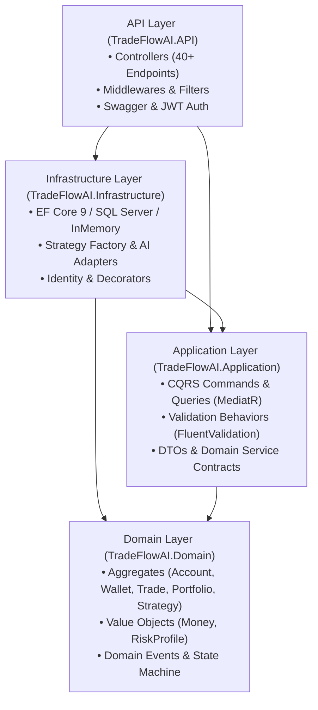
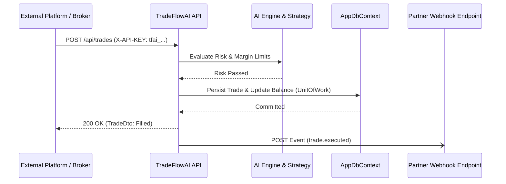

# TradeFlowAI ⚡ — Autonomous AI Trading Platform API

[](https://dotnet.microsoft.com/)
[](#architecture)
[](#design-patterns-inventory)
[](LICENSE)
[](https://github.com/Mohammedtalat1)

> **TradeFlowAI** is an enterprise-grade, production-ready ASP.NET Core 9 Web API engineered around **Clean Architecture**, **Domain-Driven Design (DDD)**, and **CQRS with MediatR**. It provides autonomous trading capabilities, AI strategy signal evaluation, automated risk guardrails, and a multi-protocol Integration Hub for third-party brokers, fintech platforms, and trading bots.

---

## 🏛️ Clean Architecture & System Layers

The codebase strictly adheres to the Clean Architecture dependency rule: **Inner layers define domain invariants and contracts; outer layers implement technical details and infrastructure.**



### 1. `TradeFlowAI.Domain` (Core / Zero External Dependencies)
- **Entities & Aggregate Roots**: `Account`, `Wallet`, `Trade`, `Portfolio`, `Position`, `TradingStrategy`.
- **Value Objects**: Immutable `Money` with multi-currency arithmetic and invariant checks; `RiskProfile` with mathematical risk boundary enforcement.
- **Domain Events**: `TradeExecutedEvent`, `TradeCancelledEvent`, `FundsDepositedEvent`, `FundsWithdrawnEvent`, `PortfolioRebalancedEvent`, `RiskLimitBreachedEvent`.
- **State Machines**: Strict trade lifecycle states (`Pending` → `Submitted` → `PartiallyFilled` → `Filled` / `Cancelled` / `Rejected` / `Expired`).

### 2. `TradeFlowAI.Application` (Use Cases & Orchestration)
- **CQRS Pattern**: Segregated command mutations from read queries.
- **Pipeline Behaviors (Chain of Responsibility)**:
  - `ValidationBehavior`: Pre-execution validation via FluentValidation.
  - `LoggingBehavior`: Structured logging with request tracing.
  - `PerformanceBehavior`: Slow execution threshold diagnostics.
- **Ports & Interfaces**: Contracts for AI Strategy Engines, Market Data Feeds, Payment Gateways, Webhook Dispatchers, and Caching.

### 3. `TradeFlowAI.Infrastructure` (Adapters & Technical Mechanisms)
- **EF Core 9 Persistence**: Clean entity mappings, transactions, and unit of work.
- **AI Strategy Engine**: Machine learning signal generation and backtesting simulation.
- **Strategy Pattern & Factory**: Swappable algorithmic implementations (`Momentum`, `MeanReversion`, `AiDriven`).
- **Resilience Decorators**: Transparent logging and retry decorators wrapping the AI Engine.
- **ASP.NET Core Identity & JWT**: Secure authentication with access tokens and refresh tokens.

### 4. `TradeFlowAI.API` (Presentation & HTTP Boundaries)
- **RESTful Endpoints**: Over 40 documented HTTP endpoints across 10 functional modules.
- **Middleware Pipeline**: RFC 7807 ProblemDetails error handling, HTTP execution logging, and API-Key extraction.
- **Interactive Swagger UI**: Interactive API documentation at application root with Dual-Auth (JWT Bearer & API-Key).

---

## 💎 Design Patterns Inventory

TradeFlowAI serves as a comprehensive portfolio showcase of **12 Gang of Four (GoF) and Enterprise Architectural Patterns**:

| # | Pattern | Layer | Implementation Details |
|---|---|---|---|
| 1 | **Repository Pattern** | Domain / Infrastructure | `IRepository<T, TId>`, `IAccountRepository`, `ITradeRepository` decouple data access from business logic. |
| 2 | **Unit of Work** | Domain / Infrastructure | `IUnitOfWork` coordinates multi-repository transactions atomically via EF Core transactions. |
| 3 | **CQRS** | Application | Segregated commands (`ExecuteTradeCommand`) and queries (`GetTradeHistoryQuery`) using MediatR. |
| 4 | **Mediator Pattern** | Application / API | Decouples HTTP controllers from application use cases via `ISender` and `IRequestHandler`. |
| 5 | **Chain of Responsibility** | Application | MediatR pipeline behaviors (`ValidationBehavior`, `LoggingBehavior`, `PerformanceBehavior`). |
| 6 | **Strategy Pattern** | Infrastructure | `IStrategyAlgorithm` with swappable algorithms: `MomentumStrategy`, `MeanReversionStrategy`, and `AiDrivenStrategy`. |
| 7 | **Factory Pattern** | Infrastructure | `StrategyFactory` dynamically instantiates the correct algorithm based on `StrategyType`. |
| 8 | **Decorator Pattern** | Infrastructure | `AiStrategyEngineLoggingDecorator` and `AiStrategyEngineRetryDecorator` wrap `IAiStrategyEngine` transparently. |
| 9 | **State Machine Pattern** | Domain | `Trade` aggregate strictly controls valid lifecycle transitions and prevents invalid state mutations. |
| 10 | **Observer Pattern** | Domain / Infrastructure | Domain events (`IDomainEvent`) raised by aggregates and dispatched upon `SaveChangesAsync`. |
| 11 | **Adapter Pattern** | Infrastructure | `MarketDataService` and `PaymentGatewayService` adapt external APIs to unified domain contracts. |
| 12 | **Value Object Pattern** | Domain | Immutable `Money` and `RiskProfile` types with self-validation and structural equality. |

---

## 🎯 OOP & SOLID Principles Enforcement

- **S — Single Responsibility Principle (SRP)**: Each CQRS command handler, domain aggregate, repository, and controller handles one singular concern.
- **O — Open/Closed Principle (OCP)**: Adding a new trading algorithm only requires adding a class implementing `IStrategyAlgorithm`; no existing code is modified.
- **L — Liskov Substitution Principle (LSP)**: Any `IStrategyAlgorithm` can substitute another seamlessly in the `StrategyFactory` without altering caller behavior.
- **I — Interface Segregation Principle (ISP)**: Focused interfaces (`IReadRepository<T, TId>`, `IWriteRepository<T, TId>`, `IMarketDataService`, `IPaymentGateway`).
- **D — Dependency Inversion Principle (DIP)**: High-level modules in Application and Domain depend strictly on abstractions, never on concrete Infrastructure classes.

---

## 🔌 Third-Party Integration Hub

TradeFlowAI is engineered for integration with external fintech applications, crypto exchanges, and brokerages:



### Supported Webhook Events:
- `trade.executed` — Order fill confirmation with execution price & quantity
- `trade.cancelled` — Notification of order cancellation
- `funds.deposited` — Inflow credit confirmation
- `funds.withdrawn` — Outflow debit confirmation
- `risk.limit_breached` — Circuit breaker or risk threshold alert
- `strategy.signal` — Real-time AI algorithmic signal generation
- `portfolio.rebalanced` — Portfolio composition and market valuation updates

---

## 📡 API Endpoint Overview

### 🔐 Authentication (`/api/auth`)
- `POST /api/auth/register` — Register a new user
- `POST /api/auth/login` — Login and obtain JWT & refresh tokens
- `POST /api/auth/refresh` — Refresh expired access token
- `POST /api/auth/logout` — Revoke refresh token
- `GET /api/auth/me` — Current authenticated user profile

### 👤 Accounts (`/api/accounts`)
- `GET /api/accounts` — List accounts
- `GET /api/accounts/{id}` — Get account details
- `POST /api/accounts` — Create trading account
- `PUT /api/accounts/{id}/risk-profile` — Update risk parameters
- `DELETE /api/accounts/{id}` — Deactivate account
- `GET /api/accounts/{id}/audit-log` — Account activity audit log

### 💰 Funds (`/api/funds`)
- `GET /api/funds/balance` — Current wallet balance
- `POST /api/funds/deposit` — Deposit capital
- `POST /api/funds/withdraw` — Request withdrawal
- `GET /api/funds/transactions` — Paginated transaction history
- `GET /api/funds/transactions/{id}` — Transaction details

### 📊 Portfolio (`/api/portfolio`)
- `GET /api/portfolio` — Current portfolio summary
- `GET /api/portfolio/positions` — List open positions
- `GET /api/portfolio/performance` — P&L, ROI, and Sharpe ratio
- `GET /api/portfolio/snapshots` — Historical portfolio snapshots
- `POST /api/portfolio/rebalance` — Trigger portfolio rebalance

### 📈 Trades (`/api/trades`)
- `GET /api/trades` — Historical trades (paginated)
- `GET /api/trades/{id}` — Trade details
- `GET /api/trades/open` — Currently active/pending orders
- `POST /api/trades` — Place a manual or automated trade
- `DELETE /api/trades/{id}` — Cancel an open trade
- `GET /api/trades/statistics` — Win rate, profit factor, gains/losses

### 📉 Market Data (`/api/marketdata`)
- `GET /api/marketdata/assets` — Supported tradable assets
- `GET /api/marketdata/assets/{symbol}/price` — Real-time price
- `GET /api/marketdata/assets/{symbol}/candles` — OHLCV candlestick data
- `GET /api/marketdata/assets/{symbol}/summary` — 24-hour summary
- `GET /api/marketdata/assets/{symbol}/orderbook` — Level 2 order book snapshot

### 🤖 AI Strategies (`/api/strategies`)
- `GET /api/strategies` — List all AI strategies
- `GET /api/strategies/{id}` — Strategy configuration details
- `POST /api/strategies` — Create a new strategy
- `POST /api/strategies/{id}/activate` — Activate strategy for an account
- `POST /api/strategies/{id}/deactivate` — Deactivate strategy
- `POST /api/strategies/{id}/backtest` — Run historical backtest
- `GET /api/strategies/{id}/backtest/{runId}` — Retrieve backtest report
- `GET /api/strategies/{id}/signals` — Evaluate real-time AI signal

### 🛡️ Risk Management (`/api/riskmanagement`)
- `GET /api/riskmanagement/metrics` — Exposure and drawdown metrics
- `GET /api/riskmanagement/circuit-breakers` — Circuit breaker status
- `POST /api/riskmanagement/circuit-breakers/{id}/reset` — Reset tripped circuit breaker
- `GET /api/riskmanagement/limits` — Account risk thresholds
- `PUT /api/riskmanagement/limits` — Update risk boundaries

### 🔔 Notifications (`/api/notifications`)
- `GET /api/notifications` — User alert history
- `POST /api/notifications` — Send an alert notification
- `PUT /api/notifications/{id}/read` — Mark alert as read
- `DELETE /api/notifications/{id}` — Delete notification
- `GET /api/notifications/preferences` — Get user delivery preferences
- `PUT /api/notifications/preferences` — Update notification preferences

### 🔌 Integration Hub (`/api/integration`)
- `GET /api/integration/webhooks` — List registered webhooks
- `POST /api/integration/webhooks` — Register a webhook endpoint
- `DELETE /api/integration/webhooks/{id}` — Unregister a webhook
- `GET /api/integration/api-keys` — List API keys
- `POST /api/integration/api-keys` — Generate a new API key
- `DELETE /api/integration/api-keys/{id}` — Revoke an API key
- `GET /api/integration/events` — Supported webhook event types
- `POST /api/integration/test-webhook` — Dispatch test webhook event

### 🏥 System Health (`/health`)
- `GET /health` — Overall system health & component statuses
- `GET /health/ready` — Kubernetes readiness probe
- `GET /health/live` — Kubernetes liveness probe

---

## 🚀 Getting Started

### Prerequisites
- [.NET 9.0 SDK](https://dotnet.microsoft.com/download/dotnet/9.0)
- (Optional) [Docker Desktop](https://www.docker.com/) for containerized deployment

### 1. Clone & Build
```bash
git clone https://github.com/Mohammedtalat1/TradeFlowAI.git
cd TradeFlowAI
dotnet restore
dotnet build
```

### 2. Run the Application
```bash
dotnet run --project src/TradeFlowAI.API/TradeFlowAI.API.csproj
```
The application starts with an in-memory database pre-seeded with sample trading accounts, funded wallets ($100k USD), AI strategies, and positions.

Navigate to **`http://localhost:5000/`** (or the console port) to view the **Interactive Swagger UI**.

### 3. Run Unit Tests
```bash
dotnet test
```

### 4. Run via Docker Compose
```bash
docker-compose up --build
```

---

## 📦 Pushing to GitHub

To push this project to your GitHub account:

```bash
# 1. Initialize Git repository
git init

# 2. Add files
git add .

# 3. Commit
git commit -m "feat: complete TradeFlowAI platform with Clean Architecture, CQRS, and 12 Design Patterns"

# 4. Link to your GitHub repository
git remote add origin https://github.com/Mohammedtalat1/TradeFlowAI.git

# 5. Push to main branch
git branch -M main
git push -u origin main
```

---

## 👤 Author

**Mohammed Talat**  
GitHub: [@Mohammedtalat1](https://github.com/Mohammedtalat1)
